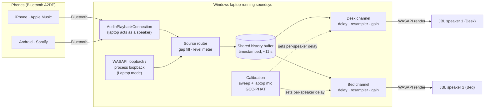

# soundsys

**Two ordinary Bluetooth speakers, one synced sound, with a Windows laptop as the hub.**

soundsys receives audio from your phone over Bluetooth (or takes whatever the laptop itself is playing) and sends it to two Bluetooth speakers at once. Each speaker gets its own delay buffer, so both play in sync even though Bluetooth adds a different delay on each one. It works with any phone and any music app, needs no extra hardware, and doesn't use your Wi-Fi.

> Status: **v0.1.0-alpha**. Everything except the real-hardware checks is built and tested (see [docs/OVERNIGHT_REPORT.md](docs/OVERNIGHT_REPORT.md)). First run on real speakers: [docs/TOMORROW.md](docs/TOMORROW.md).

## How it works



- **Phone mode** (default): the laptop shows up as a Bluetooth speaker on your phone. Any app works, and play, pause, skip and volume stay on the phone. If both phones are paired, whichever started streaming most recently wins.
- **Laptop mode**: soundsys captures what the laptop plays (Spotify via Spotify Connect, the Apple Music app, anything). The Bluetooth radio then carries only the two outgoing streams.
- **Sync**:
  - each speaker reads the shared buffer at its own delay, with 1 ms steps in the UI;
  - a drift controller nudges each speaker's resampling rate (by up to ±0.1 %) so clocks never drift apart;
  - *Auto-calibrate* plays a short sweep on each speaker, listens with the laptop mic, and lines them up.
- **Drop-outs**: if a speaker turns off, the other keeps playing. When it comes back, it rejoins within a few seconds at its saved delay.

## Install

1. Download the latest zip from [Releases](https://github.com/ishaanmakam/soundsys/releases):
   - `soundsys-<version>-win-arm64.zip` for Snapdragon / Arm laptops (e.g. Surface Laptop 7)
   - `soundsys-<version>-win-x64.zip` for Intel / AMD laptops
2. Unzip it anywhere, e.g. `C:\Apps\soundsys`.
3. Run `soundsys.exe`. It sits in the tray (bottom-right, near the clock).

Nothing to install, no admin rights, no drivers. Settings live in `%LOCALAPPDATA%\soundsys\settings.json`.

## First-time setup

1. **Pair the speakers with Windows**: Settings → Bluetooth & devices → Add device. Turn both speakers on first.
2. **Pair your phone with the laptop** the same way (the phone starts the pairing from its Bluetooth screen).
3. **Open soundsys.**
   - **Speakers** tab: both JBLs are preselected. Rename them if you like ("Desk", "Bed").
   - **Phones** tab: keep the phones that should be able to play.
4. Press **Start**. On your phone, open Bluetooth (or the AirPlay/output picker on iPhone) and choose the laptop.
5. **Sync** tab → **Auto-calibrate**. Put the laptop roughly where you listen and keep the room quiet for 5 seconds.

Want to check the hardware first? Run `soundsys-diag.exe`. It tests everything (phone link, both speakers, stutter, calibration, reconnect) and writes a report. See [docs/HARDWARE_TESTS.md](docs/HARDWARE_TESTS.md).

## Troubleshooting

| Problem | Fix |
|---|---|
| **"Windows protected your PC"** (SmartScreen) | The builds aren't code-signed. Click **More info → Run anyway**. You only need to do this once per version. |
| **"An Application Control policy has blocked this file"**, or the app silently won't open | **Smart App Control** is on and blocks unsigned apps; there's no "Run anyway". Either turn it off (Windows Security → App & browser control → Smart App Control → Off; note that on some Windows versions it can't be turned back on without a reset), or build and run from source with your own signing. See [TOMORROW.md](docs/TOMORROW.md#step-0-smart-app-control-read-first). |
| The phone doesn't list the laptop as a speaker | Press **Start** in soundsys first (the laptop only offers itself as a speaker while soundsys is running in Phone mode). Make sure the phone is enabled on the **Phones** tab. Toggle Bluetooth off and on on the phone. |
| "Bed is off or out of range" | Turn the speaker on, or bring it closer. soundsys keeps retrying and rejoins on its own. |
| Sound also comes out of the laptop | Windows is playing the incoming audio on the laptop speakers too. Run `soundsys-diag` once; it detects which suppression method works on your laptop and saves it. |
| Speakers sound like an echo | Run **Auto-calibrate** again from where you sit. Or use the click track and the manual slider: move it until the two clicks merge into one. |
| Occasional stutter | Bluetooth is busy (three streams in Phone mode). Try Laptop mode, move the speakers closer, or turn off other Bluetooth devices. soundsys automatically adds a little buffering after repeated drop-outs. |
| "Windows is also sending sound straight to Desk" | In Windows sound settings, choose the laptop speakers as the output. soundsys sends to the JBLs itself. |

## Build from source

Requires the .NET 10 SDK (`winget install Microsoft.DotNet.SDK.10`).

```powershell
dotnet build soundsys.slnx
dotnet test soundsys.slnx
dotnet run --project src/Soundsys.App            # the app
dotnet run --project src/Soundsys.App -- --simulated   # with simulated speakers/phones (silent)
dotnet run --project src/Soundsys.Diag -- probe  # silent environment probe
```

Projects: `Soundsys.Engine` holds the DSP, sync, state machines and simulated devices, with no Windows dependency. `Soundsys.Windows` holds the WASAPI and WinRT integration, `Soundsys.App` the WPF UI, and `Soundsys.Diag` the hardware checks. Design docs are in [docs/](docs/): [SPEC](docs/SPEC.md), [PLAN](docs/PLAN.md), [DECISIONS](docs/DECISIONS.md) and [UI_DESIGN](docs/UI_DESIGN.md).

## License

MIT. See [LICENSE](LICENSE).
