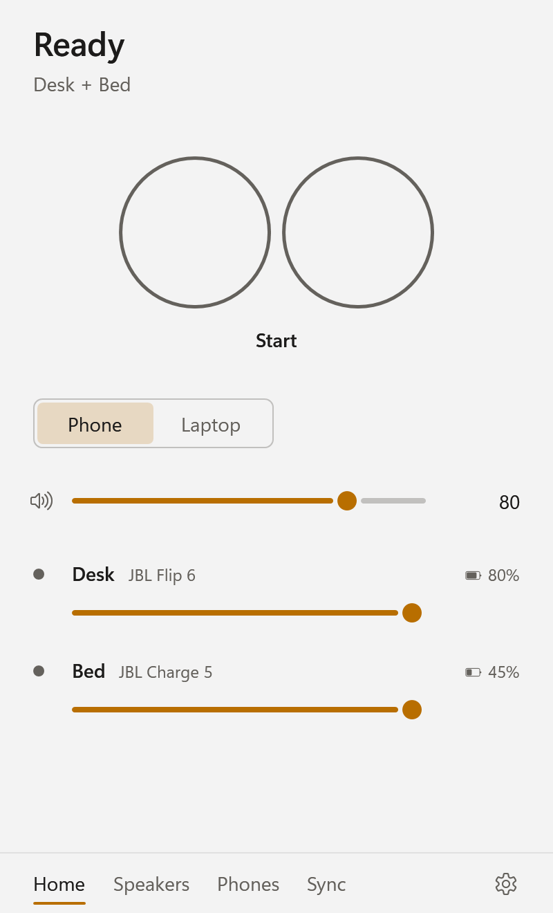
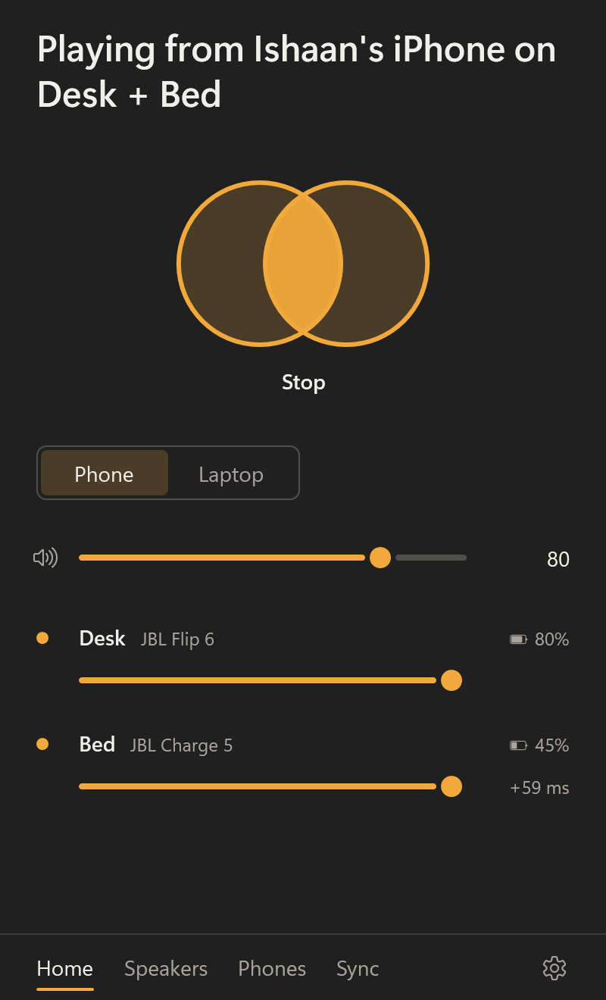
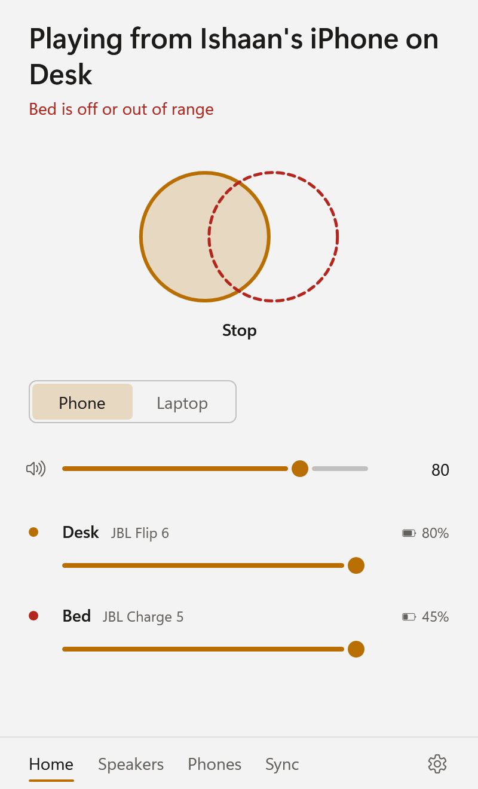
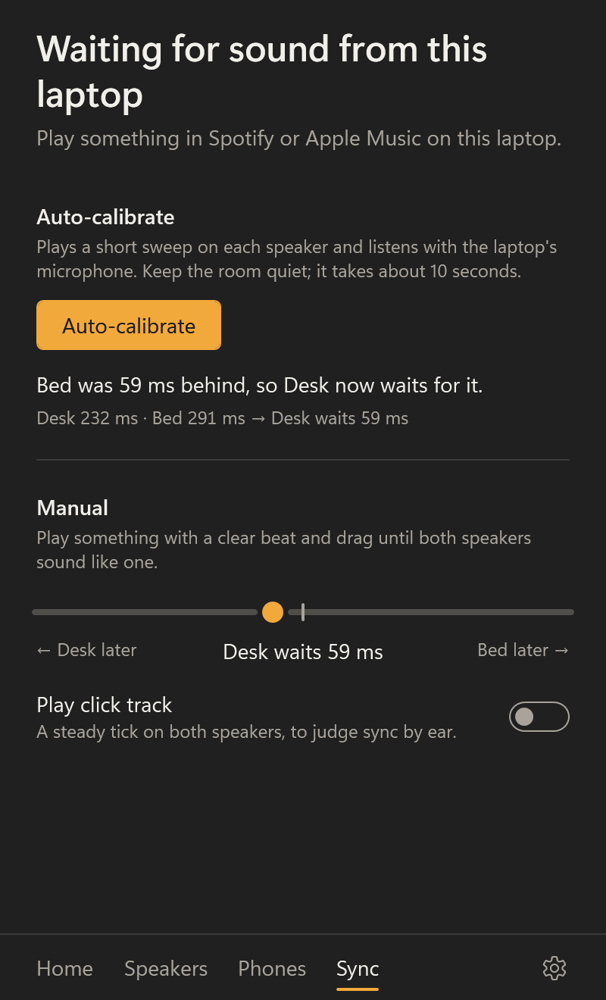

# Overnight report: 2026-11-12

**Bottom line:** everything planned for tonight is done: the engine, the Windows integration, the UI, the simulated end-to-end flow, the diag kit, CI, the v0.1.0-alpha pre-release, and docs, and every result below is backed by CI or local evidence. **Before anything else tomorrow, read [TOMORROW.md](TOMORROW.md) step 0.** Smart App Control is enforcing on this laptop and may block unsigned soundsys builds; I didn't change that setting.

| Ready | Playing | One speaker dropped | Sync |
|---|---|---|---|
|  |  |  |  |

*Screenshots are rendered by the app tests on every CI run (light and dark, 15 states). All of them are in [docs/screenshots](screenshots/).*

## "Done for tonight" checklist

| Requirement | Status | Evidence |
|---|---|---|
| All engine tests green | ✅ | **235 tests** (137 engine + 69 Windows + 29 app) pass on **win-x64 and win-arm64** (CI runs listed below) |
| Simulated drift, 1 h at ±50 ppm | ✅ | 3600 s simulated in 14.7 s; max misalignment **0.0042 ms** over 353,982 blocks; 0 underruns / jumps / glitches |
| Calibration accuracy within 2 ms | ✅ | 36-case grid (delays 0–420 ms × SNR 30/10/0 dB × RT60 0/0.3/0.6 s): max error **0.001 ms**. Reflection 1.6× louder than the direct path: 60.001 ms (true 60). Simulated room through the whole engine: 59.05 ms (true 59), second pass 0.14 ms |
| Reconnect | ✅ | The dropped speaker plays again **250 ms** after it returns, aligned to **0.028 ms**; the other speaker has 0 glitches and 0 underruns |
| Builds for arm64 + x64 | ✅ | CI builds natively on `windows-11-arm` and `windows-latest`, and publishes self-contained single-file `soundsys.exe` + `soundsys-diag.exe` for each RID |
| Runs end-to-end in simulated mode | ✅ | **Driven through the real UI with Windows UI Automation**, using the local Release build, `soundsys.exe --simulated` (silent): it opens on Ready with both JBLs preselected → Laptop → **Start** → "Playing this laptop's sound on Desk + Bed" after **242 ms**. Then Sync → **Auto-calibrate** shows each step live and reports "Bed was 59 ms behind, so Desk now waits for it." (Desk 232 ms, Bed 291 ms) in 5.2 s. The 29 app tests cover every state against the simulated engine, including "speaker drop shown within 1 s". |
| CI green; v0.1.0-alpha pre-release | ✅ | Every merge to main has a green CI run. Tag `v0.1.0-alpha` triggered [release run 43207255125](https://github.com/ishaanmakam/soundsys/actions/runs/43207255125) (test → package arm64 + x64 → release). **[Pre-release published](https://github.com/ishaanmakam/soundsys/releases/tag/v0.1.0-alpha)**: `soundsys-0.1.0-alpha-win-arm64.zip` (101 MB) and `…-win-x64.zip` (108 MB), each with `soundsys.exe`, `soundsys-diag.exe`, LICENSE and the setup notes, plus SHA-256 files (download and hash verified). The app's update checker reads this release. |
| soundsys-diag + TOMORROW.md ready | ✅ | `soundsys-diag` runs all 9 checks. CI runs it end-to-end on simulated devices on every push (8 PASS, suppression correctly SKIPPED in simulation). It also ran locally. [TOMORROW.md](TOMORROW.md), [HARDWARE_TESTS.md](HARDWARE_TESTS.md) |
| OVERNIGHT_REPORT.md | ✅ | This file |

## What was built

| Phase | Branch → main | What |
|---|---|---|
| 0 | `main` | .NET 10 SDK 10.0.404 (arm64) installed via winget; first commit (README stub, .gitignore, MIT) |
| 1 Spec + plan | `phase1-scaffold` | [SPEC](SPEC.md), [PLAN](PLAN.md), [DECISIONS](DECISIONS.md); solution + six projects; hardware abstractions (`IAudioSource`, `IOutputDevice`, `IRenderTarget`, `IAudioBackend`, `IPhoneLink`, …) |
| 2 Engine (TDD) | `phase2-engine` | Shared timestamped history buffer (per-speaker delay = read-position lag); polyphase sinc resampler (SRC + drift in one stage); gain-scheduled PI drift controller; `OutputChannel` with timestamp-interpolated latency, jumps with crossfade, underrun-vs-pause classification; source router with gap fill and timeline continuity; sweep / GCC-PHAT calibrator; reconnect state machine; phone handoff; `SyncEngine` orchestrator; simulation (virtual-time scheduler, drifting / stalling / disconnecting speakers, phones, a room with a mic); settings; update checker |
| 3 Windows | `phase3-windows` (+ review fixes) | WASAPI render/capture/loopback (event-driven, MMCSS, QPC timestamps, allocation-free loops), process loopback (`ActivateAudioInterfaceAsync`), AudioPlaybackConnection link, endpoint catalog with Bluetooth detection that works on Qualcomm's offload stack, playback suppression with crash recovery, keep-awake, start-with-Windows, battery, the silent probe |
| 4 UI | `phase4-ui` | WPF tray app on the .NET 10 Fluent theme (follows system light/dark). The signature control is two rings, one per speaker, that slide together into one when playing; each ring shows its speaker's state (amber = playing, breathing = connecting, dashed red = lost). Pages: Home, Speakers, Phones, Sync, Settings, plus a hidden Developer section (5 clicks on the version) with simulated-device controls. Tray icon drawn at runtime, single instance, `--tray`, update check, plain-English error and warning strips, app icon generated by `tools/make_icon.py`. Design: [UI_DESIGN.md](UI_DESIGN.md) |
| 5 GitHub | `phase5-ci` | CI on every push/PR (format, build + test on x64 and arm64, simulated diag, publish smoke); tag `v*` → self-contained zips → GitHub Release (pre-release when the version has a suffix); README with Mermaid diagram |
| 6 Hardware kit | `phase6-diag` | `soundsys-diag`: 9 checks, waits by detection, writes `docs/PHASE0_RESULTS.md`; simulated operator for unattended runs; [TOMORROW.md](TOMORROW.md), [HARDWARE_TESTS.md](HARDWARE_TESTS.md) |

## Evidence

CI runs on `main` (all ✅), one per merge:

| Run | Merge |
|---|---|
| 43187737737 | phase5-ci |
| 43194090595 | phase3-windows |
| 43197277988 | phase2-engine (130 tests) |
| 43201459256 | phase6-diag (136 + 69) |
| 43203005940 | Windows review fixes |
| 43203854322 | render benchmark |
| 43204544968 | diag laptop-side connect |
| 43204627260 | phase4-ui (137 + 69 + 29) |
| 43206535623 | UI review fixes (final main, `0dcf9e8`) |

- **Real-time cost** (benchmark test, CI): **21–29 µs to render one speaker's 10 ms block**, which is 0.2–0.3 % of real time. DSP latency is 0.33 ms (resampler half-length). There's no extra processing block; the default jitter buffer is 50 ms and grows automatically on repeated underruns. No allocations on the real-time path, verified by tests on both architectures.

Numbers from the CI TRX logs (identical on x64 and arm64):

- **1-hour drift.** Phone +20 ppm, Desk +50 ppm, Bed −50 ppm, packet and callback jitter.
  - Alignment from 60 s to 1 h: max 0.0042 ms, mean 0.0032 ms.
  - Learned corrections: −29.8 / +69.9 ppm (truth −30 / +70).
- **Disturbances.** Inbound dropouts of 30, 120 and 400 ms, plus a 60 ms stall on one speaker: max 0.014 ms outside 1.5 s windows. The other speaker had 0 glitches.
- **Sources.** A 44.1 kHz source to 48 kHz speakers: max 0.0066 ms. Pause/resume: max 0.0007 ms, 0 underruns.
- **Switching sources** 8 times (music ↔ test signal): alignment < 0.25 ms, no controller saturation.
- **Simulated `soundsys-diag`** (CI, every push):
  - tones heard 71/63 dB above noise;
  - phone audio in 0.9 s;
  - calibration residual 0.1 ms;
  - rejoin 0.2 s;
  - drift log spread ≤ 0.4 ms.
- **Silent real-hardware probe** ([WINDOWS_PROBE.md](WINDOWS_PROBE.md)):
  - AudioPlaybackConnection works unpackaged (selector and enumeration); no phone was paired, so the full test waits for tomorrow;
  - default-output loopback delivers 10 ms packets continuously;
  - process loopback works;
  - the QPC time base is confirmed;
  - the capture loop allocates nothing in steady state.

## Bugs found and fixed tonight (root cause first)

1. **Calibration test hang in CI.** Under xUnit's SynchronizationContext, `ConfigureAwait(false)` continuations were queued to the thread pool while the test advanced virtual time past them. Found with blame-hang plus a timeout message that named the stuck step. Fix: drive simulated time with no sync context, which matches the app's threads.
2. **Start-up acquisition transient** (0.34 ms for about 40 s). This was a cold-start integrator; I added gain scheduling, and it now settles to about 0.05 ms.
3. **Source switches nudged the speakers apart** (up to 1.3 ms; the controllers saturated at −1000 ppm). The router reset its timeline on every switch. Fix: keep the timeline continuous by filling the switch gap with silence.
4. **Code review of the engine.** Calibration sweeps were truncated after fix 3: the windows were placed before the gap fill. Calibration now starts a fresh timeline segment, and sweep quality went from 71/61 to 76/73 dB. Also fixed:
   - container-following could pick the wrong device;
   - 10 Hz status polling enumerated COM endpoints and read battery each time (now cached);
   - calibration killed a running test signal.
5. **Code review of the Windows integration:**
   - a shutdown deadlock in the endpoint watcher;
   - a use-after-free on the process-loopback activation timeout;
   - container lookups that never expired, or retried a 3 s query forever;
   - a raw COM exception escaping when mute failed;
   - phones stuck in an error state;
   - a leaked connection;
   - a crash-unmute marker deleted before the unmute happened.
6. **Seqlock reader could spin forever** if the capture thread was preempted mid-publish. It's now time-bounded at 1 ms, so a real-time thread can't stall.
7. **A flaky allocation test on arm64.** Tiered JIT/OSR allocated once inside the measured window; the test now measures a fully warmed second pass.
8. **Code review of the UI:**
   - **The window could freeze** while Start opened a slow Bluetooth speaker, because the 10 Hz status poll waited on the engine lock. Status now returns the last snapshot when the lock is busy.
   - **UI calls could reach the engine out of order** (a fast slider drag could leave a stale value; Start-then-Stop could race). They now run one at a time in order.
   - Also fixed: a rejected speaker pick now reloads, and restart waits longer for the old instance.

## Incidents (things that touched this laptop beyond building)

- **The UI agent's first local test run launched the real app** (real Windows backend) inside the test host, because creating a WPF `Application` fired its startup code.
  - No audio played: no speakers were selected, since only your Beats are paired.
  - The startup registry entry was not written.
  - It did create `%LOCALAPPDATA%\soundsys` with a default settings file and a log, which the agent deleted. It made one anonymous update-check request to the GitHub Releases API (generic user agent, no personal data). Its window and tray icon probably showed until the test exited.
  - Root cause fixed: the app's startup code now only runs from `soundsys.exe` itself, and tests never construct it.
- **I launched `soundsys.exe --simulated` locally three times** for the UI Automation checks. Simulated mode is fully in memory and silent. It leaves `%LOCALAPPDATA%\soundsys\settings.simulated.json` and `soundsys.log`. The real `settings.json` doesn't exist, so tomorrow starts fresh. There's no Run-key entry and no mute marker.
- **The silent probe ran twice** (agent and me):
  - endpoint enumeration;
  - a ≤ 1 s loopback capture;
  - process-loopback activation on its own process.

  It never played audio, opened the microphone, changed volume or mute, or called `OpenAsync`.

## Decisions

There are 40+ one-line decisions with rationale in [DECISIONS.md](DECISIONS.md). The key ones:
- **WPF on .NET 10** rather than WinUI 3: native ARM64, plain `dotnet publish`, built-in Fluent theme.
- **Unpackaged zip distribution**; a sparse package only if the phone test shows AudioPlaybackConnection needs identity.
- **One shared history buffer**, where each speaker's delay is its read lag.
- **One resampler stage** for SRC and drift together.
- **Phone capture path and double-audio suppression are measured by the diag, not assumed.**
- **I didn't touch Smart App Control.**

**Skills used:** the `superpowers:*` skills aren't installed in this session, so I followed their intent manually (spec → plan → TDD → review → verify → merge). `frontend-design` isn't installed either; I read its SKILL.md from the marketplace and applied it (design doc: [UI_DESIGN.md](UI_DESIGN.md)). The installed `code-review` skill was run on the engine and the Windows layer, and its findings were verified and fixed.

## Known risks (what tomorrow's hardware run will settle)

1. **Smart App Control** may block the unsigned app. Your options are in TOMORROW.md step 0.
2. **Two A2DP sinks at once on Qualcomm's Bluetooth offload stack.** This is the key unknown, and the `tones` check answers it.
3. **Phone capture path.** Does AudioPlaybackConnection audio show up as a capture endpoint, or only on the default output (loopback)? With Qualcomm offload, Windows may play it in the DSP where loopback can't see it. The `phone` check answers this.
4. **Double audio.** If capture is loopback-based and this driver's loopback is post-mute, the laptop speakers will play along. The `suppression` check tries a session mute and then an endpoint mute, and reports honestly. A fix without a virtual cable may not exist on this driver.
5. **Package identity for AudioPlaybackConnection.** There's no sign it's needed: every static entry point works unpackaged. The sparse-package plan is in WINDOWS_PROBE.md if the phone test shows otherwise.
6. **3 streams on one radio** (phone mode) may stutter. The `stutter` check compares against 2-stream Laptop mode, and the engine raises its buffer automatically after repeated underruns.
7. **Each speaker's internal DAC clock vs. the incoming A2DP stream is invisible to Windows.** soundsys corrects everything it can observe. The optional `--drift-hour` log will show whether the speakers drift acoustically. If they do, the next step is periodic quiet re-calibration.
8. **The calibration results are on idealised synthetic signals.** Real rooms, speaker responses, the SBC codec and laptop-mic processing will be worse. The target is 2 ms, and synthetic error was 0.001 ms, so there's plenty of margin. The engine requests raw-mode capture to bypass mic effects where supported.
9. **The `WasapiOutputDevice` render path has never run on real hardware** (it would have been audible). The `tones` check is its first run.
10. **Minor:** in real-time simulation, after a calibration both drift controllers briefly show a common-mode correction transient. Alignment stays within 0.4 ms.

## Not done, and why

- **Real-hardware verification.** No speakers or phone were connected tonight. Everything that needs them is queued in `soundsys-diag` and [TOMORROW.md](TOMORROW.md).
- **Code signing / Smart App Control.** Signing needs a certificate (paid, or SignPath's free open-source program, which needs an application), and the brief rules out paid services. I didn't disable SAC. Your call tomorrow.
- **MSIX / sparse package.** Not built, because nothing so far shows AudioPlaybackConnection needs package identity. The exact plan is in [WINDOWS_PROBE.md](WINDOWS_PROBE.md) if the phone test says otherwise.
- **Laptop-mode suppression test in the diag.** Muting Spotify's / Apple Music's session while process loopback keeps capturing is implemented in the app, but the diag only tests suppression for Phone mode (it would need Spotify playing on the laptop).
- **Smaller review items I chose not to fix tonight**, each low impact:
  - an event-driven capture stream that silently stalls doesn't fault on its own (auto-faulting would also fire during normal phone pauses);
  - log rotation only happens at start-up;
  - the speaker-name edit hold isn't tied to the selected speaker;
  - the simulated host isn't cleaned up if its construction throws;
  - a duplicate error message on a failed startup-toggle;
  - a registry read per tray-icon update.
- **Simulated app memory is about 380 MB** (WPF plus a real-time simulation). Not profiled.
- **The "still running in the tray" balloon** shows once per run, not once ever.
- **Not yet run in real mode:** the tray menu and the app on real hardware (TOMORROW.md step 5).
